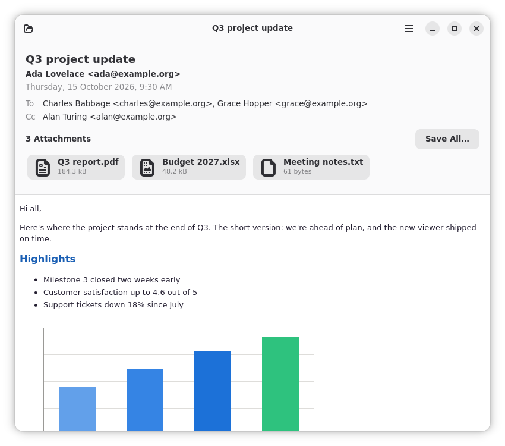

# MSG Viewer

A GNOME app for reading Microsoft Outlook `.msg` files on Linux. Double-click a `.msg` attachment in Files and read it like an email instead of an opaque binary file.

## Install

Download `MSGViewer-v1.0.0.flatpak` from the [latest release](https://github.com/larsw/MSGViewer/releases/latest) and install it with `flatpak install --user MSGViewer-v1.0.0.flatpak`. It needs the GNOME 51 runtime from Flathub. A Flathub listing is on its way.

## What it does

- Opens `.msg` files from Files, from the Open dialog, or by drag and drop. Each file gets its own window.
- Shows the subject, sender, date and recipients, then the message body: HTML with its embedded images, plain text, or HTML/text recovered from Outlook's RTF.
- Blocks remote content (images, trackers and so on) unless you allow it for the message you're reading.
- Lists attachments, which you can open or save, one by one or all at once. Images, PDFs and text open with a click; executables, scripts and macro-enabled files get a warning first. Messages attached to a message open in a new window.
- Shows meetings, contacts, tasks and notes, and a notice for signed and encrypted messages.
- Finds text, zooms, and shows messages in the font you choose.
- Shows as much as it can read from damaged files.

It doesn't edit, reply, send, or connect to mail accounts. See [docs/adr/0006-v1-scope.md](docs/adr/0006-v1-scope.md) for what is deliberately out of scope.

## Technology

- Rust, gtk4-rs and libadwaita, with UI defined in Blueprint and built with Meson driving Cargo.
- A GTK-free parser crate, `outlook-msg`, built on `cfb`.
- Bodies are rendered in WebKitGTK 6 with JavaScript disabled.
- Distributed as a Flatpak on Flathub, app ID `io.github.larsw.MSGViewer`.

Design decisions are recorded in [docs/adr/](docs/adr/), and the project's vocabulary in [GLOSSARY.md](GLOSSARY.md).

## License

[Apache-2.0](https://www.apache.org/licenses/LICENSE-2.0)
